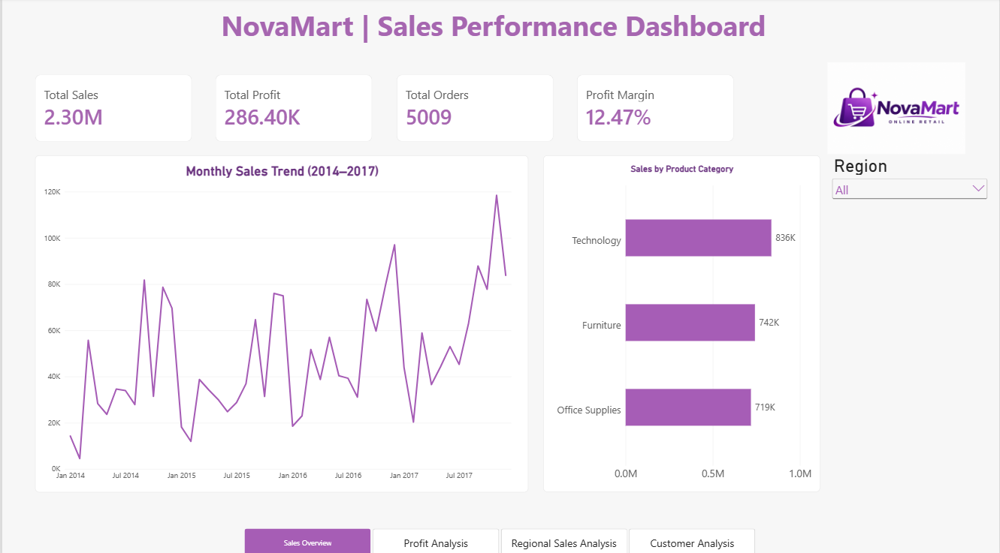
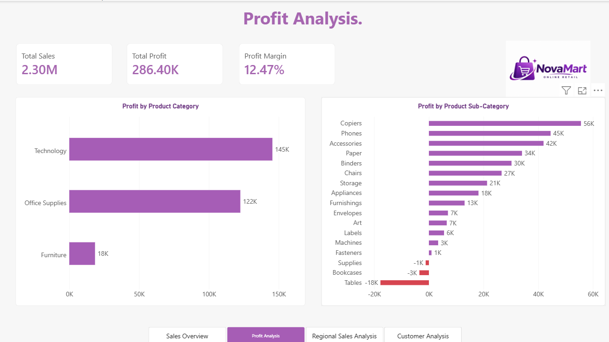
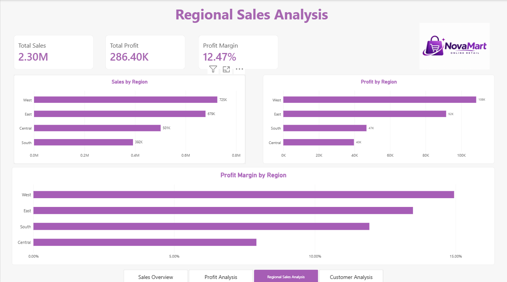
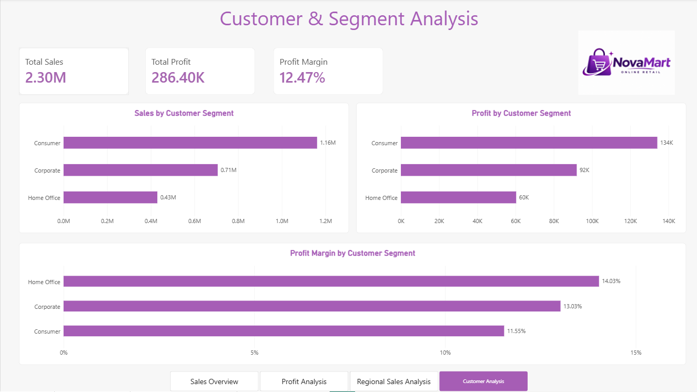

# 📊 NovaMart | Sales Performance Dashboard

### Interactive Sales & Profitability Analysis Using Power BI

An interactive, four-page Power BI dashboard designed to analyze retail sales performance, profitability, regional trends, and customer segments using historical sales data from 2014 to 2017.

The project transforms transactional sales data into meaningful business insights through data visualization, KPI tracking, and interactive reporting.

---

## 🎯 Project Objectives

The primary objectives of this project are to:

- Analyze overall sales and profitability.
- Track monthly sales trends.
- Identify profitable and loss-making product categories.
- Compare regional sales and profit performance.
- Evaluate customer segments based on revenue and profitability.
- Support data-driven business decision-making.

---

## 🛠️ Tools & Technologies

| Tool | Purpose |
|---|---|
| Power BI Desktop | Dashboard development and visualization |
| Power Query | Data cleaning and transformation |
| DAX | KPI calculations and measures |
| Data Visualization | Business performance analysis |
| GitHub | Project documentation and portfolio |

---

## 📈 Key Performance Indicators

| KPI | Value |
|---|---|
| Total Sales | 2.30M |
| Total Profit | 286.40K |
| Total Orders | 5,009 |
| Profit Margin | 12.47% |

*Values represent the overall dataset displayed in the dashboard.*

---

## 📸 Dashboard Preview

### 1. Sales Overview

Provides an overview of total sales, profit, orders, monthly sales trends, and product category performance.

### 2. Profit Analysis

Highlights profitability across product categories and subcategories, including loss-making products.

### 3. Regional Sales Analysis

Compares sales, profit, and profit margins across four geographical regions.

### 4. Customer & Segment Analysis

Analyzes customer segments based on sales contribution, profit, and profit margins.

---

## 🔍 Key Business Insights

### 1. Technology Leads in Sales

Technology generated approximately 836K in sales, outperforming Furniture and Office Supplies.

### 2. Technology Is the Most Profitable Category

Technology contributed approximately 145K in profit, followed by Office Supplies at 122K.

### 3. Loss-Making Subcategories Identified

Several product subcategories recorded losses:

- Tables: approximately -18K
- Bookcases: approximately -3K
- Supplies: approximately -1K

These categories may require further investigation into pricing, discounts, and operational costs.

### 4. West Region Leads in Performance

The West region generated approximately 725K in sales and 108K in profit, making it the strongest region by these measures.

### 5. Central Region Has Lower Profitability

The Central region generated approximately 501K in sales but only 40K in profit, indicating a comparatively lower profit margin.

### 6. Consumer Segment Generates the Highest Sales

The Consumer segment contributed approximately 1.16M in sales.

However, the Home Office segment achieved the highest profit margin at approximately 14.03%.

---

## 🧹 Data Preparation

Power Query was used during the data preparation process.

The workflow involved preparing the dataset for analysis, checking data types, and organizing fields for reporting.

DAX measures were used to calculate key business metrics, including total sales, total profit, total orders, and profit margin.

---

## 📊 Dashboard Features

- Four interactive report pages
- KPI cards for business performance monitoring
- Monthly sales trend visualization
- Product category and subcategory comparisons
- Regional sales and profitability analysis
- Customer segment analysis
- Region-based filtering
- Interactive page navigation
- Visual highlighting of negative profits

---

## 📥 How to View the Dashboard

1. Download the `NovaMart_Sales_Performance_Dashboard.pbix` file from this repository.
2. Install Microsoft Power BI Desktop.
3. Open the downloaded PBIX file.
4. Explore the four dashboard pages.
5. Use the available filters and navigation buttons to interact with the report.

**Note:** Dashboard screenshots are available above for users who do not have Power BI Desktop installed.

---

## 💡 Skills Demonstrated

- Data Cleaning and Transformation
- Power Query
- DAX Measures
- Data Analysis
- KPI Development
- Business Intelligence
- Data Visualization
- Dashboard Design
- Business Insights and Reporting

---

## 👩‍💻 Author

**Vaishnavi Garige**

B.Sc. Computer Science Graduate | Aspiring Data Analyst

---

⭐ This project was developed as part of my hands-on learning journey in Data Analytics and Business Intelligence.
